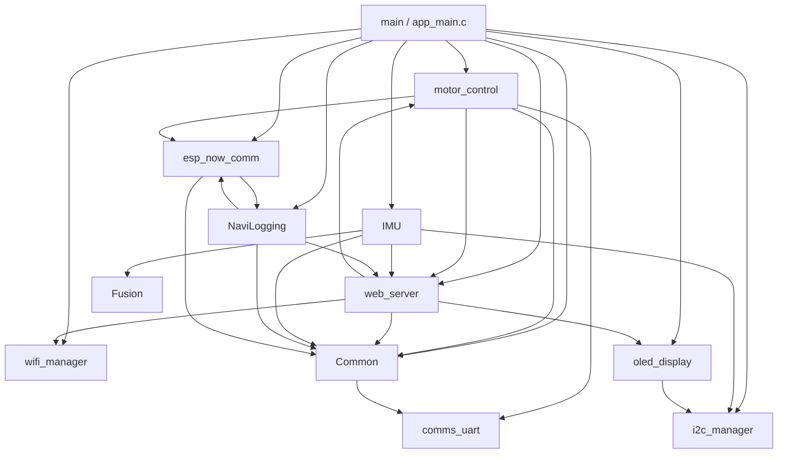
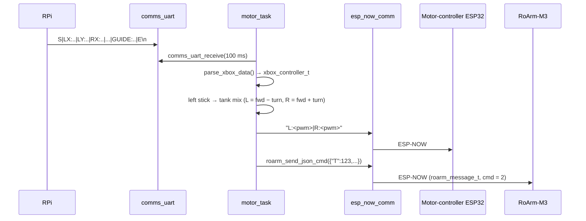

# Architecture

A map of the WAVE ROVER lower-computer firmware: which parts exist, how they
talk to each other, and where to look when changing something.

For hardware background and build instructions, see the top-level
[README](../README.md).

---

## 1. Repository layout

```
wave_rover_driver/
├── ESP32/                      ESP-IDF port – the firmware that is actively developed
│   ├── Application/            the firmware project (idf.py runs here)
│   │   ├── main/app_main.c     entry point: init order + OTA validation loop
│   │   └── components/         one ESP-IDF component per subsystem (see §3)
│   ├── UnitTests/              Espressif unit-test-app, pointed at Application/components
│   ├── Tools/TemplateComponentGenerator/   generates a new component skeleton
│   └── *.sh                    Build / Flash / Monitor / Configure / Clean / ... wrappers
├── WaveRoverDriver/            original Waveshare Arduino firmware (reference only, not built)
├── Dependencies/esp-idf        ESP-IDF git submodule (pinned to v5.4 by Build.sh)
└── docs/                       this file
```

`WaveRoverDriver/` is the code the ESP-IDF port started from. It is useful for
looking up how Waveshare did something, but nothing in `ESP32/` depends on it.

---

## 2. System context

The ESP32 sits in the middle of several devices. Only the Raspberry Pi link is
wired; everything else is wireless.

```mermaid
flowchart LR
    Xbox[Xbox 360 controller] -->|USB receiver| RPi[Raspberry Pi<br/>upper computer]
    RPi <-->|UART0 @ 921600<br/>controller frames in,<br/>logs + IMU out| ESP[ESP32<br/>this firmware]

    ESP -->|ESP-NOW<br/>'L:&lt;pwm&gt;&#124;R:&lt;pwm&gt;'| MC[Motor-controller ESP32<br/>+ external H-bridges]
    ESP -->|ESP-NOW<br/>roarm_message_t + JSON| ARM[RoArm-M3 ESP32]
    GPS[Navi / GPS ESP32] -->|ESP-NOW<br/>navi_coordinates_type| ESP

    ESP <-->|WiFi STA<br/>HTTP + WebSocket| Browser[Browser]
    ESP -->|HTTPS GET firmware .bin| OTA[OTA server]

    ESP --- I2C[I2C bus<br/>OLED · QMI8658 · AK09918]
    ESP -.->|LEDC PWM + GPIO<br/>DIRECT mode, unused| Motors[On-board H-bridge<br/>not connected]
```



ESP-NOW peers are identified by **hard-coded MAC addresses**:

| Peer                   | Variable                | Defined in                                             |
|------------------------|-------------------------|--------------------------------------------------------|
| Motor-controller ESP32 | `motor_controller_mac`  | `motor_control/Source/motor_control.c`                 |
| RoArm-M3               | `roarm_mac`             | `motor_control/Source/roarm_m3_motor_control.c`        |
| Navi / GPS sender      | `navi_esp32_mac`        | `NaviLogging/Source/NaviLogging.c`                     |

ESP-NOW peers are added with `channel = 0`, i.e. they use whatever channel the
WiFi STA connection ended up on. The other devices have to be on that same
channel; the firmware logs it at boot ("ESP-NOW will use WiFi Channel: N").

---

## 3. Components

All components live in `ESP32/Application/components/<name>/` with
`Include/` (public header) and `Source/` (implementation). `wifi_manager` uses
lowercase `include/` and `src/`.

| Component        | Responsibility | Public API (header) | Owns a task? |
|------------------|----------------|---------------------|--------------|
| `Common`         | `LOG_TO_RPI(...)` – printf-style logging that is sent to the RPi over UART | `Common.h` | no |
| `comms_uart`     | UART0 driver wrapper (921600 baud, pins GPIO1/3 set explicitly, because the bootloader unroutes them when the console is on UART1) | `comms_uart.h` | no |
| `i2c_manager`    | Owns the single I2C master bus (SDA 32, SCL 33, 400 kHz) and hands out the bus handle | `i2c_manager.h` | no |
| `oled_display`   | 4-line text buffer on the OLED; `oled_write_string` + `oled_refresh` | `oled_display.h` | no |
| `wifi_manager`   | WiFi STA bring-up; **blocks** until connected or 5 retries fail. Calls back on disconnect / status change | `wifi_manager.h` | no (event handlers) |
| `esp_now_comm`   | Thin ESP-NOW wrapper (init, peers, send) + the receive router | `esp_now_comm.h`, `esp_now_comm_callbacks.h` | no (WiFi task callbacks) |
| `web_server`     | HTTP server, browser UI, WebSocket broadcast, HTTPS OTA, in-RAM log buffer | `web_server.h` | httpd's own task |
| `motor_control`  | Reads Xbox frames from UART, drives the rover (direct or via ESP-NOW) and the RoArm-M3 | `motor_control.h`, `roarm_m3_motor_control.h` | `motor_task` |
| `NaviLogging`    | Receives GPS fixes over ESP-NOW, stores the latest, logs it | `NaviLogging.h` | `navi_coordinates_processing_task` |
| `IMU`            | QMI8658 (accel + gyro) and AK09918 (magnetometer) drivers + Fusion AHRS → roll/pitch/yaw | `IMU.h` (only `imu_init`) | two read tasks |
| `Fusion`         | Third-party AHRS library (x-io Technologies), vendored – see `source_repo.md` | `Fusion.h` | no |

### Component dependency graph

Arrows go from a component to what it `REQUIRES` (from each `CMakeLists.txt`;
ESP-IDF built-ins left out).



Two dependency cycles exist and are worth knowing about before refactoring:

- `motor_control` ⇄ `web_server`: the web UI calls `motor_move_*`, and
  `motor_control` calls `web_server_print` for status messages.
- `esp_now_comm` ⇄ `NaviLogging`: the receive router in
  `esp_now_comm_callbacks.c` calls into `NaviLogging`, and `NaviLogging`
  registers its peer through `esp_now_comm`.

`web_server_print` is used as a general-purpose "status log" by several
components, which is why so much depends on `web_server`.

---

## 4. Boot sequence

`app_main()` calls `init_components()` and then `print_system_info()`. The order
matters; each step logs its result via `LOG_TO_RPI` and **continues on
failure** (no step aborts boot).

| # | Step | Why it is here |
|---|------|----------------|
| 1 | `nvs_flash_init()` (erase + retry if corrupt) | WiFi stack stores calibration/credentials in NVS |
| 2 | `comms_uart_init()` | Needed first so every later step can `LOG_TO_RPI` |
| 3 | `i2c_manager_init()` | Bus must exist before OLED and IMU |
| 4 | `oled_init()` | Sets global `oled_err`, which others check before drawing |
| 5 | `esp_netif_init()`, default event loop, default STA netif | Prerequisites for WiFi |
| 6 | `wifi_manager_init()` | **Blocks** until connected or retries exhausted |
| 7 | `esp_now_comm_init()` | Needs the WiFi radio running (not necessarily connected) |
| 8 | `web_server_init()` | Starts httpd and registers URIs |
| 9 | `motor_init(ESP_NOW_MOTOR_CONTROLLER)` | Adds peers (motor controller: fatal on failure; RoArm: reported only), starts `motor_task` |
| 10 | `NaviLogging_init()` | Adds GPS peer, starts its task |
| 11 | `imu_init()` | Probes sensors, starts both IMU read tasks |
| 12 | `print_system_info()` | Chip/flash/MAC to UART, OLED and web log |

The motor mode is chosen at compile time by the `mode` variable in
`init_components()`.

After init, `app_main` loops every 2 s. If the running image is
`ESP_OTA_IMG_PENDING_VERIFY` (freshly OTA'd), it waits 3 cycles and then calls
`esp_ota_mark_app_valid_cancel_rollback()`. A crash before that makes the
bootloader roll back to the previous image.

---

## 5. Runtime: tasks and data flows

| Task | Created in | Period | Priority |
|------|------------|--------|----------|
| `app_main` | ESP-IDF | 2 s | default main task |
| `motor_task` | `motor_control.c` | UART read (100 ms timeout) + 20 ms delay | idle + 5 |
| `navi_coordinates_processing_task` | `NaviLogging.c` | 1 s | idle + 2 |
| `accel_gyro_data_read` | `IMU.cpp` | 50 ms (`vTaskDelayUntil`) | idle + 1 |
| `magnetometer_data_read` | `IMU.cpp` | 50 ms (`vTaskDelayUntil`) | idle + 1 |
| httpd | `esp_http_server` | event-driven | ESP-IDF default |

ESP-NOW and WiFi callbacks run in the WiFi task, so they should stay short.

### 5.1 Driving and arm control (main control path)



**UART frame from the RPi** (one line per controller update):

```
S|LX:v|LY:v|RX:v|RY:v|LT:v|RT:v|DPX:v|DPY:v|A:v|B:v|X:v|Y:v|LB:v|RB:v|BACK:v|START:v|GUIDE:v|E\n
```

Parsing is `strstr` per key, and a missing key reads as 0. The axis/button
mapping (determined experimentally) is documented in the comment on
`parse_xbox_data()`.

**Controller mapping** (`process_xbox_input()`):

| Input | Action |
|-------|--------|
| Left stick | Rover drive (differential mix, deadzone 5000) |
| Right stick X / Y | Arm joint 1 base / joint 2 shoulder (speed ∝ deflection) |
| D-pad up/down | Joint 3 elbow |
| D-pad left/right | Joint 4 wrist pitch |
| LB / RB | Joint 5 wrist roll |
| LT / RT | Joint 6 gripper close / open. **Ignored while any other joint input is active** |
| A (edge) | Arm to init pose (`{"T":100}`), then blocks the task for 3 s |
| B (edge) | Stop all 6 arm axes |

Every joint sends a "stop" (`cmd:0`) on the release edge.

**Motor modes** (`motor_control_mode_t`):

- `ESP_NOW_MOTOR_CONTROLLER` (**in use**): left/right PWM go out as the
  ASCII string `L:<int>|R:<int>` to the motor-controller ESP32, which drives
  the external H-bridges. The local LEDC and GPIO are **not** configured in
  this mode. This firmware relies on the motor controller stopping the motors
  by itself when packets stop arriving. How it does that, and how quickly, is
  defined in the `wave_rover_motor_driver` repo, so check there.
- `DIRECT_MOTOR_CONTROL` (**unused, legacy**): drives the driver board's
  on-board H-bridge directly. The rover's motors have since been replaced
  with bigger ones on external H-bridges, so the on-board H-bridge is not
  connected to anything. Pins: PWMA/PWMB on GPIO 25/26 (LEDC, 8-bit,
  100 kHz), direction AIN1/AIN2 = 21/17, BIN1/BIN2 = 22/23.

All drive output goes through `rover_apply_speed()` in `motor_control.c`,
which picks the backend from the mode stored by `motor_init()`. The public
`motor_stop` / `motor_move_*` / `motor_turn_*` work in both modes.

**RoArm-M3 protocol** (`roarm_m3_motor_control.c`): every message is a
`roarm_message_t` struct sent raw over ESP-NOW. `cmd = 2` means "JSON in
`message`, deferred processing". The JSON uses Waveshare's `T` codes:

| `T` | Meaning | Helper |
|-----|---------|--------|
| 100 | Move to init pose | `roarm_move_init` |
| 101 | Single joint to angle | `roarm_control_joint` |
| 104 | Move to XYZ | `roarm_move_xyz` |
| 106 | Gripper angle | `roarm_control_gripper` |
| 114 | LED brightness | `roarm_control_light` |
| 123 | Constant-speed joint move (axis, cmd 0=stop/1=−/2=+, spd) | `roarm_send_constant_ctrl` (static, in `motor_control.c`) |

`roarm_send_json_cmd` waits 20 ms before every send, so each arm command adds
20 ms to the `motor_task` loop.

### 5.2 IMU / orientation

```
QMI8658 ─┐                                            ┌─► WebSocket /ws  (web_server_ws_broadcast_imu_orientation)
         ├─► accel_gyro_data_read ─► FusionOffset ─► FusionAhrs ─┤
AK09918 ─┘    (magnetometer task writes                  └─► LOG_TO_RPI "IMU: Roll: … AccelZ: …"
               magnetometer_x/y/z globals)
```

Uses 9-DOF fusion when magnetometer data is available and falls back to 6-DOF
otherwise. Sample period is 50 ms (`FUSION_SAMPLE_PERIOD`).

### 5.3 GPS (NaviLogging)

ESP-NOW receive → `on_data_recv_callback()` in `esp_now_comm_callbacks.c` routes
by sender MAC → `NaviLogging_handle_received_coords()` checks that the length
equals `sizeof(navi_coordinates_type)` and copies it under a mutex with a
non-blocking take → the 1 s task logs new fixes to the RPi.

The payload is the raw C struct, so **sender and receiver must agree on the
exact layout** of `navi_coordinates_type` (doubles + ints, native padding).

To accept data from a new ESP-NOW sender, add a MAC branch in
`on_data_recv_callback()`.

### 5.4 Web server

| URI | Purpose |
|-----|---------|
| `/` | Control page (HTML in `HTML_page.c`) |
| `/control?dir=forward\|backward\|left\|right\|stop&seq=N&sid=S` | Calls `motor_move_*` / `motor_stop`. `seq` is required; within one session (`sid`, random per page load) a request whose `seq` is not greater than the last one processed is ignored. A new `sid` starts a new count, so a reloaded page works immediately |
| `/print` | Returns the `web_server_print` log buffer |
| `/ota` | Starts HTTPS OTA from `FIRMWARE_UPGRADE_URL` (`web_server.c`), server cert in `certs/`. See below |
| `/reset` | Reboots |
| `/ws` | WebSocket; IMU orientation is pushed to all connected clients |

**OTA failure reporting.** `perform_ota_update()` first opens a plain TLS
connection to the server with `esp-tls` (`ota_check_server()`), because
`esp_https_ota()` only returns generic errors. If something fails,
`ota_report_failure()` writes the reason, in plain language and with what to
do about it, to the web log (`/print`), to the RPi over UART, and as a short
reason on the OLED. It tells apart: server unreachable (`No server`),
certificate doesn't match the embedded one (`Cert mismatch`), other TLS
errors, invalid image (`Bad image`), running image not yet confirmed after a
previous OTA (`Retry in 10s`), and other download failures.

The web drive buttons are the backup control path when the RPi or Xbox
controller is unavailable. They only need WiFi. While a button is held, the
page resends its command every 50 ms (`COMMAND_REPEAT_INTERVAL` in
`HTML_page.c`), because the motor controller stops when packets stop arriving.
The interval has to stay shorter than the motor controller's command timeout;
check `wave_rover_motor_driver` for its current value. On release the page
sends `stop`. If the page loses focus or is hidden, it releases. If the
browser or WiFi dies, the repeats stop and the motor controller stops the
rover.

The Xbox path sends nothing while the stick is centred (ESP-NOW mode), so the
two control paths don't fight. If both are active, the last packet wins.

### 5.5 Logging: where output goes

| Mechanism | Destination | Used for |
|-----------|-------------|----------|
| `LOG_TO_RPI(...)` | UART0 → RPi | Boot log, IMU data, GPS, ESP-NOW events |
| `web_server_print(...)` | RAM buffer served at `/print` | Status/errors from most components |
| `ESP_LOGx(TAG, ...)` | ESP-IDF console on **UART1** (TX GPIO17 / RX GPIO16, set in `sdkconfig`), not visible through `Monitor.sh` | Low-level debug |
| `oled_write_string` | OLED, 4 lines | Version, WiFi status, IP, OTA progress |

UART0 carries **both** the control frames coming in and the logs going out, so
the RPi side has to separate log lines from its own traffic.

---

## 6. Safety stops

For `ESP_NOW_MOTOR_CONTROLLER` mode (the one in use):

| Trigger | What this firmware does | Where |
|---------|-------------------------|-------|
| Joystick back in deadzone | Sends nothing; motor controller stops on its own | `process_xbox_input` |
| No UART data (RPi/controller gone) | Sends nothing; motor controller stops on its own | `motor_task` |
| WiFi disconnect | `motor_stop()` → sends `L:0\|R:0` | `on_wifi_disconnect` in `app_main.c` |
| Web button released / Stop | `motor_stop()` → sends `L:0\|R:0` | `/control?dir=stop` |
| Browser/WiFi dies mid-press | Repeats stop; motor controller stops on its own | `HTML_page.c` |
| B button | Stop all 6 arm axes | `process_xbox_input` |
| Joint released | Stop that joint | `process_xbox_input` |

"Stops on its own" is the motor controller's behaviour when packets stop
arriving. See the `wave_rover_motor_driver` repo for how that's implemented.

The Xbox path deliberately does **not** send a stop when the stick is centred
or the UART goes quiet. That would override the web UI, which is the backup
path for exactly the case where the RPi isn't sending.

In `DIRECT_MOTOR_CONTROL` mode (unused) the stick-centred and UART-silence
stops brake the on-board H-bridge on every loop instead. The UART-silence stop
fires after `UART_SILENCE_STOP_MS` (**500 ms**) without UART data.

---

## 7. Configuration and secrets

| What | Where |
|------|-------|
| WiFi SSID/password | `wifi_manager/include/WiFi_Credentials.h` – **git-ignored, create locally** with `#define WIFI_SSID` / `#define WIFI_PASSWORD` |
| Firmware version | `FW_VERSION` in `main/app_main.c` |
| OTA URL | `FIRMWARE_UPGRADE_URL` in `web_server/Source/web_server.c` |
| OTA server cert | `web_server/certs/apache_ip_cert.crt`, embedded at build time. It must be the exact self-signed cert Apache serves (`/etc/ssl/certs/apache-selfsigned.crt` on the OTA PC). If the server cert is regenerated, copy it here and flash once over **serial**, because the old image can no longer connect to OTA. The firmware does not check cert validity dates (`CONFIG_MBEDTLS_HAVE_TIME_DATE` is off and the clock is never set), so an expired cert still works; only a *different* cert breaks OTA. |
| Peer MACs | see table in §2 |
| Motor mode | `mode` in `init_components()` (`app_main.c`) |
| UART baud/pins | `comms_uart.h` |
| I2C pins/freq | `i2c_manager.h` |
| ESP-IDF options | `Application/sdkconfig` (edit via `./Configure.sh`) |

---

## 8. Build, flash, test

All scripts are in `ESP32/` and wrap `idf.py`:

| Script | Does |
|--------|------|
| `Build.sh` | Installs apt deps, inits the esp-idf submodule at v5.4, installs the toolchain, builds |
| `Flash.sh` / `Monitor.sh` | Pick a `/dev/ttyUSB*` port, then `idf.py flash` / `monitor` |
| `Configure.sh` | `idf.py menuconfig` |
| `InitTarget.sh` | `idf.py set-target esp32` |
| `Clean.sh` | `idf.py fullclean` |
| `ESP-IDF_Terminal.sh` | Shell with the IDF environment exported |
| `UploadImageToServer.sh` | Copies the built `.bin` to the local OTA server directory |
| `UnitTests/UnitTests_Build.sh`, `UnitTests_Execute.sh` | Build/run the on-target unit-test app |

**Unit tests.** `UnitTests/` is Espressif's unit-test-app with
`EXTRA_COMPONENT_DIRS` pointing at `../Application/components`. A component is
tested by adding a `test/` folder that registers Unity `TEST_CASE`s
(`oled_display/test/` is the current example). See
`UnitTests/WAVE_ROVER_README.md`.

---

## 9. Common changes: where to start

| I want to... | Start here |
|--------------|------------|
| Add a new subsystem | `Tools/TemplateComponentGenerator/TemplateComponentGenerator.py`, then add it to `REQUIRES` in `main/CMakeLists.txt` and an init block in `init_components()` |
| Change a controller button mapping | `process_xbox_input()` in `motor_control.c` |
| Add a field to the RPi→ESP32 frame | `xbox_controller_t` + `fields[]`/`values[]` in `parse_xbox_data()`, plus the RPi sender |
| Add a new arm command | `roarm_m3_motor_control.c/.h` (new `T` code helper) |
| Handle a new ESP-NOW sender | MAC + branch in `esp_now_comm_callbacks.c`, `esp_now_comm_add_peer()` in the owning component |
| Add a web endpoint | `httpd_uri_t` + handler + `httpd_register_uri_handler` in `web_server.c` |
| Change what the IMU publishes | `task_read_qmi8658_data()` in `IMU.cpp` |
| Release a new firmware | Bump `FW_VERSION`, `Build.sh`, `UploadImageToServer.sh`, hit `/ota` |

---

## 10. Coding conventions

- Every `.c` file follows the section-banner template from
  `Tools/TemplateComponentGenerator/template.c` (INCLUDES, MACROS, DATA TYPES,
  GLOBAL/STATIC declarations, definitions).
- Public API: `esp_err_t <component>_<verb>(...)`. Init functions are
  `<component>_init()`.
- Shared state is guarded by a FreeRTOS mutex created in `_init()`.
- Callbacks into `main` (WiFi) go through a callback struct rather than a
  direct dependency.
